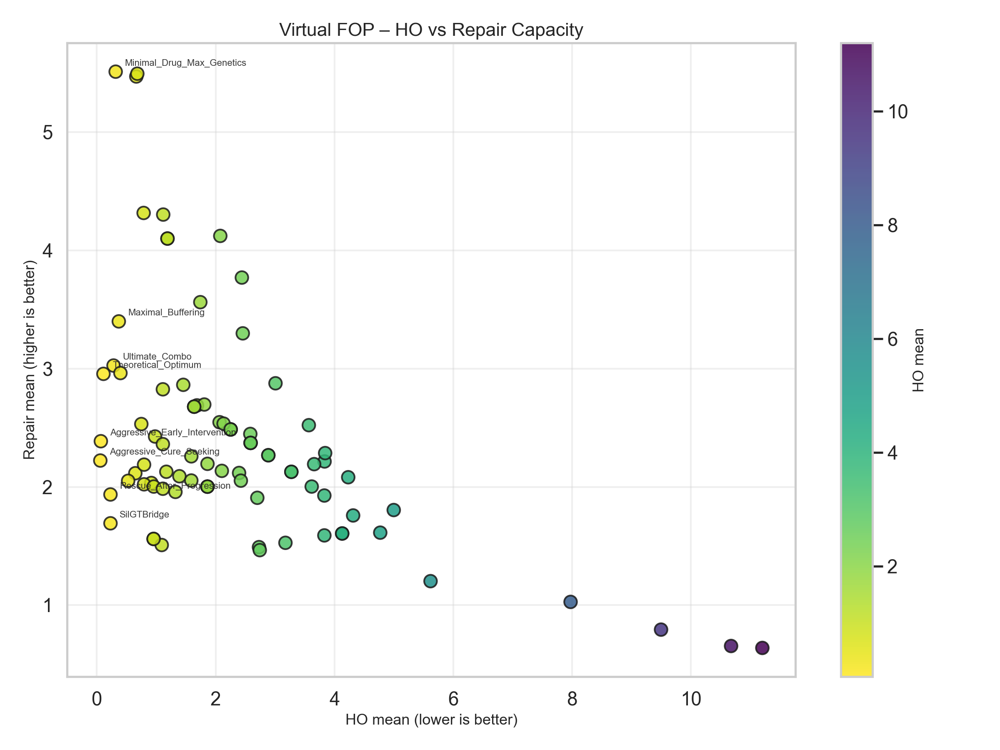
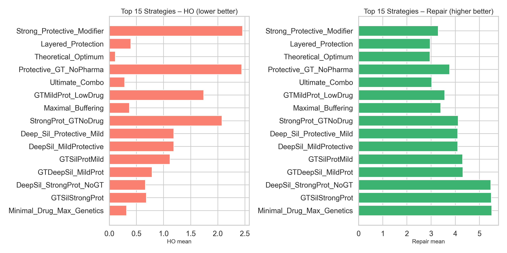
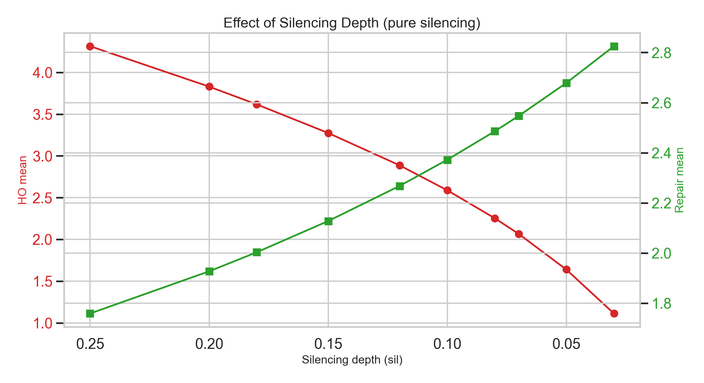
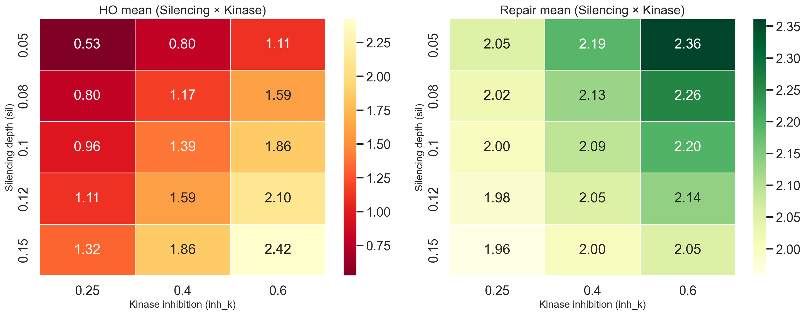

# Virtual FOP – Computational Model of Fibrodysplasia Ossificans Progressiva

**A multi-compartment, stochastic systems-biology platform for exploring disease mechanisms and therapeutic strategies in FOP.**

---

## Table of Contents

1. [Overview](#overview)
2. [Key Features](#key-features)
3. [Model Structure](#model-structure)
4. [Installation](#installation)
5. [Running the Model](#running-the-model)
6. [Docker Support](#docker-support)
7. [Saving Results](#saving-results)
8. [Visualization](#visualization)
9. [Interpreting Results](#interpreting-results)
10. [Key Findings](#key-findings-from-large-ensembles)
11. [Top Performing Strategies](#top-performing-strategies)
12. [Recommended Next Steps](#recommended-next-steps)
13. [Limitations & Future Work](#limitations--future-work)
14. [License](#license)

---

## Overview

Fibrodysplasia Ossificans Progressiva (FOP) is an ultra-rare genetic disorder caused by gain-of-function mutations in the *ACVR1/ALK2* gene (most commonly R206H). The mutant receptor drives inappropriate BMP signaling, converting soft-tissue progenitors into heterotopic bone after inflammatory triggers (“flares”).

This project implements a computational (“virtual”) FOP model that allows rapid *in silico* testing of therapeutic strategies, including:

- Allele-specific gene silencing
- Kinase and non-canonical pathway inhibition
- Protective genetic modifiers
- Realistic gene-therapy delivery (efficiency, rise time, escape, residual activity)
- Complex multi-modal combinations

The model is fully stochastic (trauma/flare events follow a Poisson process) and has been tested with ensembles of up to **100,000 virtual patients**.

---

## Key Features

| Feature                        | Description                                                                 |
|--------------------------------|-----------------------------------------------------------------------------|
| Multi-compartment dynamics     | Systemic inflammation → local tissue → signaling → progenitors → HO         |
| Stochastic flares              | Acute trauma events generated as a Poisson process                          |
| Protective Modifier module     | Simulates natural genetic buffering (mild patient phenotypes)               |
| Gene-therapy realism           | Incomplete efficiency, delayed onset, slow escape, residual mutant activity |
| Homeostatic repair score       | Explicit penalty for strategies that destroy normal healing                 |
| CUDA acceleration              | Automatic GPU support via PyTorch (falls back to SciPy/CPU)                 |
| Large-scale Monte-Carlo        | Successfully run with 100,000 realizations                                  |
| Result export                  | JSON + summary CSV + per-strategy detailed CSVs                             |
| Visualization suite            | Automatic plots (HO vs Repair, heatmaps, sweeps, top strategies)            |

---

## Model Structure

### State Variables (8-dimensional)

| Index | Name        | Meaning                                          |
|-------|-------------|--------------------------------------------------|
| 0     | `I_sys`     | Systemic inflammation                            |
| 1     | `I_loc`     | Local tissue inflammation                        |
| 2     | `S`         | Canonical Smad1/5/8 signaling                    |
| 3     | `noncan`    | Aggregated non-canonical signaling               |
| 4     | `FAPa`      | Activated progenitors                            |
| 5     | `H`         | Cumulative heterotopic ossification (HO)         |
| 6     | `repair`    | Homeostatic repair / normal healing capacity     |
| 7     | `corrected` | Fraction of progenitors successfully gene-edited |

### Core Parameters

**Disease & Intervention**
- `mut` – gain-of-function strength of mutant ACVR1 (classic ≈ 5.0)
- `sil` – residual mutant expression after silencing (1.0 = none, lower = stronger)
- `inh_k` – kinase / canonical pathway inhibition (1.0 = none)
- `inh_noncan` – non-canonical pathway inhibition

**Protective Modifiers** (1.0 = no protection)
- `prot_inflam` – inflammation → signaling coupling
- `prot_phos` – phosphatase / negative regulation strength
- `prot_fap` – progenitor activation rate
- `prot_noncan` – non-canonical amplification
- `prot_repair` – basal repair capacity

**Gene Therapy Delivery**
- `gt_efficiency` – maximum fraction of cells that can be corrected (0–1)
- `gt_onset` – time when gene therapy is administered
- `gt_rise_time` – time constant for correction to rise
- `gt_escape_rate` – slow loss of correction over time
- `residual_activity` – remaining mutant activity inside corrected cells

---

## Installation

```bash
pip install numpy scipy torch pandas matplotlib seaborn

```

## Running the Model
```bash
python virtual_fop_montecarlo.py
```

Key arguments inside run_ensemble():

```python
results = run_ensemble(
    n_realizations=10000,   # increase for higher statistical power
    T_end=100.0,
    seed=42,
    use_cuda=True           # set False to force CPU
)
```

## Docker Support

```bash
docker compose up --build
```
Results are automatically written to the `./results` folder on the host machine via volume mounting.

## Saving Results
- The model saves three types of output:Full raw data → `results/fop_results_YYYYMMDD_HHMMSS.json`
- Summary statistics → `results/fop_summary_YYYYMMDD_HHMMSS.csv`
- One detailed CSV per strategy → `results/per_strategy/`

---
## Visualization
Generate publication-ready plots with:
```bash
python visualize_fop_results.py results/fop_summary_XXXXXX.csv --outdir plots
```
## Generated Figures
Place the generated PNG files in a `plots/` folder next to this README so they render correctly.
1. HO vs Repair Capacity (Main Overview)
HO vs Repair
Ideal strategies appear in the bottom-right (low HO + high Repair).
2. Top Strategies Comparison
Top Strategies
Left: HO mean (lower is better)
Right: Repair mean (higher is better)
3. Effect of Silencing Depth
Silencing Sweep
Shows how pure allele-specific silencing improves HO control while preserving repair.
4. Silencing × Kinase Inhibition Heatmap
Sil × Kin HeatmapLeft heatmap = HO mean · Right heatmap = Repair mean

---

## Interpreting Results

|Metric|Meaning|Desired direction|
|------|-------|-----------------|
|HO mean / std|Final heterotopic bone volume|Lower|
|Repair mean|Homeostatic / normal healing capacity|Higher|
|HO 5–95%|Spread across random flare sequences|Narrower better|
|Strong control rate|Probability of low HO + good repair|Closer to 100%|

---

## Key Findings (from large ensembles)
From runs with up to 100,000 virtual patients:
- `Allele-specific silencing` is the single highest-leverage intervention.
- Adding a `protective genetic background` dramatically improves both HO control and repair capacity.
- Realistic gene therapy (≈ 55% efficiency) is only moderately effective unless combined with silencing or strong protective modifiers.
- Extremely aggressive multi-node blockade can drive HO almost to zero, but often reduces normal repair.
- Number of flares is very strongly correlated with final HO in untreated disease (r ≈ 0.97).
---

## Visualization Results

### 1. HO vs Repair Capacity (Main Overview)



Ideal strategies sit in the **bottom-right** corner (low HO + high Repair).

### 2. Top Strategies Comparison



Left = HO (lower better) · Right = Repair (higher better)

### 3. Effect of Silencing Depth



### 4. Silencing × Kinase Inhibition Heatmap



---
## Top Performing Strategies
|Rank|Strategy|HO mean|Repair mean|Notes|
|----|--------|-------|-----------|-----|
|1|Minimal_Drug_Max_Genetics|0.318|5.510|Best overall balance|
|2|DeepSil_StrongProt_NoGT|0.665|5.470|Excellent without gene therapy|
|3|GT55_Sil010_StrongProt|0.682|5.493|Strong realistic GT combination|
|4|Aggressive_Cure_Seeking|0.059|2.223|Lowest HO observed|
|5|Theoretical_Optimum|0.112|2.956|Very strong multi-modal approach|
|6|DeepSil_MildProtective|1.189|4.100|Best simple protective strategy|
|7|Ultimate_Combo|0.282|3.026|Strong all-rounder|
|8|Maximal_Buffering|0.370|3.399|High repair + strong HO control|

## Recommended Next Steps
- Re-run the S-tier strategies with 50k–100k realizations for final confirmation.
- Perform formal sensitivity analysis on the protective modifier parameters.
- Design a “Practical Optimum” that does not assume extremely strong protective genetics.
- Add spatial resolution or map simulation time units to real patient years.
- Couple the model to pharmacokinetic data of clinical-stage candidates.
---

## Limitations & Future Work
### Current limitations
- Single well-mixed tissue compartment
- Fixed-step integrator on GPU
- Simplified aggregation of non-canonical pathways

### Planned improvements
- Spatial / multi-site anatomy
- Adaptive ODE solvers
- Full PK/PD layers for real drugs
- Global sensitivity analysis (Sobol indices)
- Direct calibration against published mouse HO volumes and patient CT natural-history data
---
## License
This is a research / educational computational model.
You are free to use, modify, and extend it for non-commercial scientific purposes.
---
Happy modeling — and good luck in the search for better FOP therapies.


